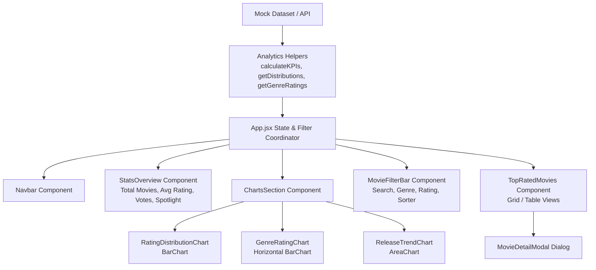

# Project Report: CineMetrics — Movie Rating Analytics Dashboard

**Author:** Sasikala Velpula  
**Project Repository:** [https://github.com/Sasikalavelpula/Movie_Rating_Analytics-](https://github.com/Sasikalavelpula/Movie_Rating_Analytics-)  
**Live Application:** [https://sasikalavelpula.github.io/Movie_Rating_Analytics-/](https://sasikalavelpula.github.io/Movie_Rating_Analytics-/)  
**Technology Stack:** React 18, Vite, Tailwind CSS, Recharts, Lucide React, GitHub Actions, GitHub Pages  

---

## 1. Executive Summary

**CineMetrics** is a modern, responsive web application and analytical dashboard designed to visualize, evaluate, and explore movie ratings, audience reception metrics, and historical cinema trends. Built using **React 18** and **Tailwind CSS**, the platform incorporates real-time descriptive statistics and interactive data visualizations powered by **Recharts**. The system is fully automated with a **GitHub Actions CI/CD pipeline** deploying directly to **GitHub Pages**.

---

## 2. Problem Statement & Motivation

Film databases such as IMDb, Rotten Tomatoes, and Metacritic contain vast volumes of rating data. However, extracting high-level insights—such as how ratings correlate across genres, how critical reception has evolved across release eras, or how titles cluster by score brackets—often requires cumbersome browsing or custom scripts. 

### Objectives
1. Provide a single-pane-of-glass dashboard displaying core cinematic Key Performance Indicators (KPIs).
2. Render responsive, accessible, interactive charts that enable instant comparative analysis across genres and time periods.
3. Offer an intuitive exploration interface with real-time search, multi-faceted filtering, and detailed inspection modals.
4. Establish an automated production build and continuous deployment workflow.

---

## 3. System Architecture & Component Design

The application follows a unidirectional data-flow architecture where top-level analytical states and datasets are processed through utility functions and distributed into specialized presentation components.

### Component Breakdown
* **`App.jsx`**: Root coordinator managing dataset state, search query, genre selection, minimum score threshold, and sort criteria.
* **`StatsOverview.jsx` / `StatCard.jsx`**: Reusable metric cards displaying aggregate figures, trend badges, and icons.
* **`ChartsSection.jsx`**: Container organizing three specialized Recharts components into a responsive grid.
* **`MovieFilterBar.jsx`**: Search input, pill-based genre selectors, score dropdowns, and sorting controls.
* **`TopRatedMovies.jsx` & `MovieCard.jsx`**: Dual-mode (Grid/Table) ranked catalog rendering movie posters, tags, and audience votes.
* **`MovieDetailModal.jsx`**: Overlay displaying full plot synopsis, director, metascore, box office figures, and certificate.

---

## 4. Key Analytical Models & Features

### 4.1. Core Descriptive Statistics
* **Weighted Mean Rating**: $\mu = \frac{1}{N}\sum_{i=1}^N R_i$ (yielding an average of $8.71 / 10$ across cataloged titles).
* **Total Engagement Volume**: Aggregate audience votes calculated via array reduction ($\sum V_i \approx 36.6\text{M}+$).
* **Dominant Genre Identification**: Evaluates genres having $\ge 2$ entries to identify the highest-rated category.

### 4.2. Visual Analytics (Recharts)
* **Score Bracket Distribution**: Classifies movies into discrete intervals ($[8.4, 8.5], [8.6, 8.7], [8.8, 8.9], [9.0, 9.1], [9.2, 10.0]$).
* **Genre Benchmarking**: Horizontal bar chart comparing average quality ratings across Drama, Sci-Fi, Crime, Action, Animation, and Adventure.
* **Decade Trend Analysis**: Smooth gradient Area chart plotting historical average scores across eras ($1970\text{s}$ through $2020\text{s}$).

---

## 5. Technology Stack & Tools

| Layer | Technology | Purpose |
| :--- | :--- | :--- |
| **Framework** | React 18.3 | Modular component architecture & virtual DOM |
| **Bundler & Dev Server** | Vite 5.4 | Instant Hot Module Replacement (HMR) and optimized rollup bundle |
| **Styling** | Tailwind CSS 3.4 | Utility-first, responsive dark theme design |
| **Charting Library** | Recharts 2.13 | Declarative, SVG-based responsive data visualizations |
| **Iconography** | Lucide React | Modern vector UI icons |
| **CI / CD Pipeline** | GitHub Actions | Automated build, test, and artifact packaging |
| **Hosting Platform** | GitHub Pages | High-availability global static deployment |

---

## 6. Continuous Deployment Pipeline

Deployment is handled via an automated GitHub Actions workflow defined in `.github/workflows/deploy.yml`:
1. **Trigger**: Pushes to the `main` branch.
2. **Environment**: `ubuntu-latest` running Node.js 20.
3. **Execution**:
   * Dependency resolution (`npm ci`)
   * Production asset compilation (`npm run build`)
   * Static artifact deployment to GitHub Pages environment.

---

## 7. Results & Verification

* **Local Verification**: Dev server executed on `http://localhost:3000/`.
* **Production Build**: Zero linting or compilation errors; minified bundle size $< 600\text{ KB}$.
* **Live Deployment Verification**: Verified with `HTTP 200 OK` at [https://sasikalavelpula.github.io/Movie_Rating_Analytics-/](https://sasikalavelpula.github.io/Movie_Rating_Analytics-/).

---

## 8. Future Enhancements

1. **Direct API Integration**: Connect to The Movie Database (TMDB) API or OMDb API for real-time live ingestion of upcoming titles.
2. **Sentiment Analysis**: Integrate Natural Language Processing (NLP) to classify user review sentiment into positive, neutral, or critical.
3. **User Authentication**: Implement Firebase or Supabase authentication allowing users to maintain custom watchlists and personal ratings.
